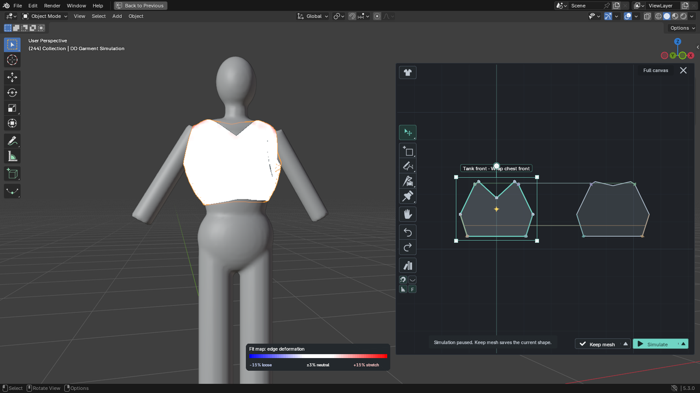
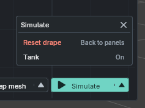
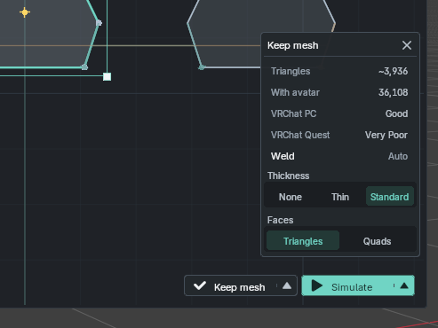

# Simulate and Keep the Garment

## Run the Simulation

- Click **Simulate** to start the drape.
- Click **Pause** to inspect it.
- Click **Reset drape** on the garment card to restore the starting arrangement. Reset does not delete finished meshes.

## Grab the Cloth While It Simulates

Choose **Grab** in the dock and drag the cloth. It keeps simulating under your hand and carries on from wherever you let go.

- **Pull** moves the cloth with your hand across the view.
- **Push** presses the cloth in along its surface.
- Use <kbd>Ctrl</kbd>+wheel or the **+** and **-** buttons to set how much cloth you pick up. The wheel on its own zooms as usual. The circle at your cursor shows the size.

Taut cloth will not follow your hand all the way. That protects the garment from being dragged through the body.

## Choose Fabric and Mesh Detail

Right-click a piece to choose its fabric or mesh detail. A fabric preset is a ready-made choice that helps the drape behave like that material.

- **Coarse:** Use for large, simple pieces and faster previews.
- **Standard:** Use for most garments.
- **Fine:** Use for small or detailed pieces such as collars and cuffs.

### Fabric Presets

Choose Silk, Knit, Cotton, Linen, Leather, or Denim to set how a piece drapes.

## Choose Simulation Quality

Quality sets how carefully **Keep mesh** finishes the garment. Choose **Draft** for the fastest result, **Standard** for everyday work, or **High** for the tightest fit and seams, especially for layers. Live draping runs at the same speed in all three.

## Adjust Individual Pieces

Right-click a piece and choose **Simulation**:

- **Freeze** holds the piece in its current shape while other pieces move.
- **Deactivate** leaves the piece out of the simulation.
- **Strengthen** makes the piece stiffer, useful for collars, lapels, waistbands, or cuffs.

## Read the Fit Map

Press <kbd>F</kbd> to show or hide the **Fit Map**, a color guide that shows where the fabric is stretched or compressed. White is close to its original length, blue shows compression, and red shows stretch. It is a visual guide, not a pressure measurement.

<figure class="dd-shot" id="shot-simulate-fit-map" data-shot='{"action":"Inspect garment stretch and compression with the Fit Map","ui_state":"Paused drape with white neutral, blue compressed, and red stretched fabric and bottom controls visible","framing":"full-editor","aspect_ratio":"16:9"}' data-shot-framing="full-editor" aria-labelledby="shot-simulate-fit-map-caption">
  

  <figcaption id="shot-simulate-fit-map-caption">Full-editor view of the paused drape with the Fit Map enabled, showing white neutral, blue compressed, and red stretched fabric alongside the bottom controls.</figcaption>
</figure>

## Simulate Clothing in Layers

1. Keep the inner garment as a mesh.
2. Open **Simulate**'s arrow and check the inner garment is **On** in **Wear over**.
3. Position the outer garment around the inner garment.
4. Choose **High** quality for layered clothing.

Kept garments are **On** by default. The exception is a kept copy of the garment you are still working on: it starts **Off**, so simulating again after a change does not collide with your earlier result. Click its row to turn it **On** if you do want to drape over it.

<figure class="dd-shot" id="shot-simulate-layer-settings" data-shot='{"action":"Enable a kept inner garment for layered draping","ui_state":"Simulate arrow menu open with a named kept inner garment listed under Wear over and set to On","framing":"close-up","aspect_ratio":"4:3"}' data-shot-framing="close-up" aria-labelledby="shot-simulate-layer-settings-caption">
  

  <figcaption id="shot-simulate-layer-settings-caption">Close-up view of the open Simulate arrow menu, showing the kept inner garment by name under Wear over with its toggle set to On.</figcaption>
</figure>

## If the Drape Fails or Looks Wrong

- Check that the correct avatar is selected and that the pieces are placed around it as expected.
- Make sure at least one piece is active in **Simulation** settings.
- If the fabric starts in the wrong place, use **Reset drape** in the **Simulate** arrow, adjust the pieces, and simulate again.
- If the result looks rough, try **Standard** or **High** quality, or use **Fine** mesh detail on small pieces.
- If cloth slides off the shoulders or hips, right-click the empty canvas and set **Friction** to **Grippy**. Use **Slippery** for loose cloth that should fall freely.

## Pin the Draped Cloth

Pins hold the cloth exactly where you put it while everything around it keeps draping. Nothing restarts.

- While you are holding the cloth with Grab, press <kbd>W</kbd>. The cloth inside the circle stays there.
- Or click the Grab tool and choose **Pin**. Every drag then pins the cloth where you release it.
- Drag a pinned spot to move it. It stays where you drop it.
- <kbd>Ctrl</kbd>+click a pinned spot to free it. **Remove pins** in the Grab menu frees all of them.

Pinned cloth shows as small dots. Pin changes are part of the editor's undo history, so <kbd>Ctrl</kbd>+<kbd>Z</kbd> and <kbd>Ctrl</kbd>+<kbd>Shift</kbd>+<kbd>Z</kbd> undo and redo them in any tool, in order with your pattern edits. A smaller circle pins less cloth, which suits a single fold. Pins stay through **Re-drape** and are baked into the mesh by **Keep mesh**. **Reset drape** clears them.

## Pinch, Steam and Puff

Click the Grab tool, choose **Pinch** or **Steam**, and click or drag across the cloth as many times as you like, then press <kbd>Space</kbd> to apply the strokes. Pinch gathers a small area into a fold. Steam shrinks a wider area, and <kbd>Shift</kbd> + drag stretches it instead. Grab's radius sets the size. For padded pieces, right-click a piece and open **Simulation > Puff**. **Clear puff and steam** removes them from a piece.

## Edit After Draping

Change a pattern, fabric or mesh density at any time. The cloth returns to its panels and **Simulate** changes to **Re-drape**. Click it, or press <kbd>Space</kbd>, and the garment starts again from the drape it had, with your change applied. To start from the flat panels instead, use **Reset drape** first.

## Keep the Finished Mesh

1. Pause on the frame you want.
2. Use the **Keep mesh** arrow for **Weld: Auto/Manual**, **Thickness** and **Faces**.
3. Click **Keep mesh**.

**Faces: Triangles** is the default. **Quads** joins triangle pairs into quads after the seams are welded, which is easier to edit and retopologize in Blender. Most of the mesh becomes quads, not a clean grid, and the triangle count for VRChat stays the same.

Keep takes a second or two to finish the cloth, then checks it against your avatar. It clears small contacts for you. If cloth is too far inside the body, Keep stops and tells you where, so you can let it settle or pull it clear.

The finished mesh is editable in Blender. Its UVs are the flat map used to place textures on the garment and follow the pattern pieces.

<figure class="dd-shot" id="shot-simulate-keep-mesh" data-shot='{"action":"Configure mesh baking options and execute Keep mesh","ui_state":"Paused drape with Keep mesh arrow expanded showing Weld Auto/Manual and Thickness options","framing":"close-up","aspect_ratio":"4:3"}' data-shot-framing="close-up" aria-labelledby="shot-simulate-keep-mesh-caption">
  

  <figcaption id="shot-simulate-keep-mesh-caption">Close-up view of the Keep mesh popup controls showing Weld Auto/Manual selection and Thickness input fields.</figcaption>
</figure>
